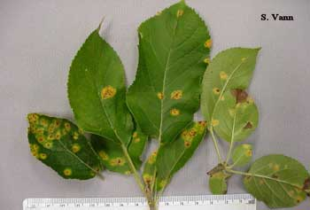
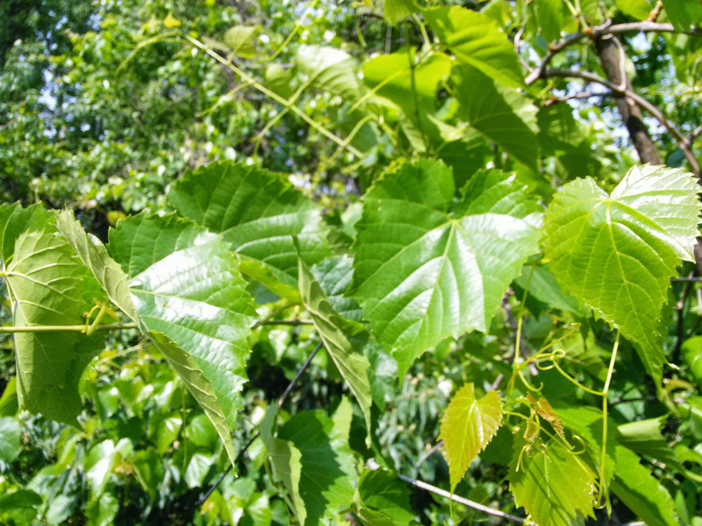
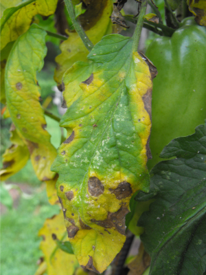

# PlantDoc: A Dataset for Visual Plant Disease Detection

[](https://creativecommons.org/licenses/by/4.0/)
[](https://github.com/your-repo/plant_doc_detection)
[](https://github.com/your-repo/plant_doc_detection)
[](https://github.com/your-repo/plant_doc_detection)
[](https://github.com/your-repo/plant_doc_detection)
[](https://github.com/your-repo/plant_doc_detection/issues)
[](https://github.com/your-repo/plant_doc_detection/pulls)
[](https://github.com/your-repo/plant_doc_detection/graphs/contributors)
[](https://github.com/your-repo/plant_doc_detection/commits)
[](https://doi.org/10.5281/zenodo.xxxxx)

A dataset for visual plant disease detection containing 2,585 images across 13 plant species and 29 disease classes. This repository hosts the standardized structure and conversion scripts for the PlantDoc dataset.

- **Project page**: `https://github.com/pratikkayal/PlantDoc-Dataset`
- **Original paper**: `https://arxiv.org/abs/1911.10317`
- **Dataset repository**: `https://github.com/pratikkayal/PlantDoc-Dataset`

## TL;DR

- **Task**: Object Detection, Image Classification
- **Modality**: RGB
- **Platform**: Ground
- **Real/Synthetic**: Real
- **Images**: 2,585 labeled images
- **Classes**: 29 disease classes across 13 plant species
  - Plant species: Apple, Bell Pepper, Blueberry, Cherry, Corn, Grape, Peach, Potato, Raspberry, Soyabean, Squash, Strawberry, Tomato
  - Disease classes: Including healthy leaves and various disease conditions
- **Resolution**: Variable (ranging from ~300×200 to ~2800×2100 pixels)
- **Annotations**: Bounding boxes in CSV format (converted to COCO format)
- **Total annotations**: 8,600 bounding boxes
- **License**: CC BY 4.0 (see LICENSE)
- **Citation**: See below

## Table of Contents

- [Download](#download)
- [Dataset Structure](#dataset-structure)
- [Sample Images](#sample-images)
- [Annotation Schema](#annotation-schema)
- [Stats and Splits](#stats-and-splits)
- [Quick Start](#quick-start)
- [Evaluation and Baselines](#evaluation-and-baselines)
- [Datasheet (Data Card)](#datasheet-data-card)
- [Known Issues and Caveats](#known-issues-and-caveats)
- [License](#license)
- [Citation](#citation)
- [Changelog](#changelog)
- [Contact](#contact)

## Download

- **Original dataset**: `https://github.com/pratikkayal/PlantDoc-Dataset`
- **This repository**: Hosts structure and conversion scripts only; place the downloaded folders under this directory.
- **Local license file**: See `LICENSE` (CC BY 4.0).

## Dataset Structure

```
PlantDoc-Object-Detection-Dataset-master/
├── plant_diseases/                 # Main category directory
│   ├── csv/                        # Per-image CSV annotation files
│   ├── images/                     # Image files (JPG/JPEG/PNG)
│   ├── labelmap.json              # Label mapping file
│   └── sets/                       # Dataset split files
│       ├── train.txt              # Training set image list
│       ├── val.txt                # Validation set image list
│       ├── test.txt               # Test set image list
│       ├── all.txt                # All images list
│       └── train_val.txt          # Train+Val combined list
│
├── annotations/                    # COCO format JSON files (generated)
│   ├── plant_diseases_instances_train.json
│   ├── plant_diseases_instances_val.json
│   └── plant_diseases_instances_test.json
│
├── scripts/                        # Conversion and utility scripts
│   ├── convert_to_coco.py         # CSV to COCO format converter
│   ├── reorganize_dataset.py      # Dataset reorganization script
│   └── update_csv_labels.py       # CSV label update script
│
├── data/                           # Original data directory
│   └── origin/                     # Original dataset files (preserved)
│       ├── TRAIN/                  # Original training images
│       ├── TEST/                   # Original test images
│       ├── train_labels.csv        # Original training labels
│       ├── test_labels.csv         # Original test labels
│       └── LICENSE.txt             # Original license file
│
├── LICENSE                         # License file
├── README.md                       # This file
└── requirements.txt                # Python dependencies
```

**Splits files format**: Each file in `sets/` contains image basenames (no extension), one per line. If missing, all images are used.

## Sample Images

<table>
  <tr>
    <th>Category</th>
    <th>Sample</th>
  </tr>
  <tr>
    <td><strong>Apple Leaf</strong></td>
    <td>
      
      <div align="center"><code>plant_diseases/images/apple_F14b.jpg</code></div>
    </td>
  </tr>
  <tr>
    <td><strong>Tomato Leaf</strong></td>
    <td>
      
      <div align="center"><code>plant_diseases/images/IMG_20150511_095517.jpg</code></div>
    </td>
  </tr>
  <tr>
    <td><strong>Potato Leaf Blight</strong></td>
    <td>
      
      <div align="center"><code>plant_diseases/images/20100816earlyblight.jpg</code></div>
    </td>
  </tr>
</table>

## Annotation Schema

- **CSV per-image schema** (stored under `plant_diseases/csv/` folder):
  - Columns: `#item, x, y, width, height, label`
  - Coordinates: `x, y` are top-left corner coordinates in pixels
  - Dimensions: `width, height` are bounding box dimensions in pixels
  - Label: Integer label ID corresponding to `labelmap.json`
  
- **COCO-style** (generated):

```json
{
  "info": {
    "year": 2020,
    "version": "1.0.0",
    "description": "PlantDoc plant_diseases train split"
  },
  "images": [
    {
      "id": 1,
      "file_name": "plant_diseases/images/example.jpg",
      "width": 800,
      "height": 600
    }
  ],
  "annotations": [
    {
      "id": 1,
      "image_id": 1,
      "category_id": 1,
      "bbox": [107.37, 48.42, 22.0, 22.0],
      "area": 484.0,
      "iscrowd": 0
    }
  ],
  "categories": [
    {
      "id": 1,
      "name": "apple_scab_leaf",
      "supercategory": "plant_disease"
    }
  ]
}
```

- **Label maps**: `plant_diseases/labelmap.json` defines the category mapping:

```json
[
  {
    "object_id": 0,
    "label_id": 0,
    "keyboard_shortcut": "0",
    "object_name": "background"
  },
  {
    "object_id": 1,
    "label_id": 1,
    "keyboard_shortcut": "1",
    "object_name": "apple_scab_leaf"
  }
]
```

**All 29 classes**: Apple Scab Leaf, Apple Leaf, Apple Rust Leaf, Bell Pepper Leaf, Bell Pepper Leaf Spot, Blueberry Leaf, Cherry Leaf, Corn Gray Leaf Spot, Corn Leaf Blight, Corn Rust Leaf, Peach Leaf, Potato Leaf, Potato Leaf Early Blight, Potato Leaf Late Blight, Raspberry Leaf, Soyabean Leaf, Squash Powdery Mildew Leaf, Strawberry Leaf, Tomato Early Blight Leaf, Tomato Septoria Leaf Spot, Tomato Leaf, Tomato Leaf Bacterial Spot, Tomato Leaf Late Blight, Tomato Leaf Mosaic Virus, Tomato Leaf Yellow Virus, Tomato Mold Leaf, Tomato Two Spotted Spider Mites Leaf, Grape Leaf, Grape Leaf Black Rot.

## Stats and Splits

### Image Statistics

- **Total images**: 2,585
- **Total annotations**: 8,600
- **Number of classes**: 29
- **Plant species**: 13 (Apple, Bell Pepper, Blueberry, Cherry, Corn, Grape, Peach, Potato, Raspberry, Soyabean, Squash, Strawberry, Tomato)

### Dataset Splits

Splits provided via `plant_diseases/sets/*.txt`. You may define your own splits by editing those files.

| Split | Images | Annotations |
|-------|--------|-------------|
| Train | 1,800  | 6,449       |
| Val   | 450    | 1,704       |
| Test  | 231    | 447         |
| **Total** | **2,481** | **8,600** |

*Note: Some images from the original dataset may not have corresponding image files due to URL encoding issues in filenames.*

## Quick Start

### Using COCO API

```python
from pycocotools.coco import COCO
import json

# Load COCO annotations
coco = COCO('annotations/plant_diseases_instances_train.json')

# Get all image IDs
img_ids = coco.getImgIds()
print(f"Total images: {len(img_ids)}")

# Get annotations for an image
ann_ids = coco.getAnnIds(imgIds=img_ids[0])
anns = coco.loadAnns(ann_ids)

# Get category information
cats = coco.loadCats(coco.getCatIds())
print(f"Categories: {[cat['name'] for cat in cats]}")

# Load image info
img_info = coco.loadImgs(img_ids[0])[0]
print(f"Image: {img_info['file_name']}")
print(f"Size: {img_info['width']}x{img_info['height']}")
print(f"Annotations: {len(anns)}")
```

### Converting to COCO format

If you need to regenerate COCO annotations from CSV files:

```bash
python scripts/convert_to_coco.py --root . --out annotations --splits train val test
```

### Dependencies

**Required**:
- `Pillow>=9.5` (for image processing)

**Optional**:
- `pycocotools>=2.0.7` (for COCO API)

Install with:
```bash
pip install -r requirements.txt
```

## Evaluation and Baselines

- **Primary metric**: 
  - Object Detection: mAP@[.50:.95], mAP@.50, mAP@.75
  - Classification: Accuracy
- **Baseline results**: According to the original paper, using this dataset can increase classification accuracy by up to 31% compared to baseline methods.

## Datasheet (Data Card)

### Motivation

India loses 35% of the annual crop yield due to plant diseases. Early detection of plant diseases remains difficult due to the lack of lab infrastructure and expertise. This dataset was created to enable computer vision approaches for scalable and early plant disease detection, which is crucial for improving crop yield and food security.

### Composition

The dataset consists of:
- **Image types**: RGB images collected from internet sources
- **Categories**: 29 disease classes across 13 plant species (Apple, Bell Pepper, Blueberry, Cherry, Corn, Grape, Peach, Potato, Raspberry, Soyabean, Squash, Strawberry, Tomato)
- **Annotation format**: Bounding box annotations for disease regions

### Collection Process

- **Source**: Images scraped from the internet
- **Annotation tool**: Images manually annotated by experts
- **Validation**: Annotation process involved approximately 300 human hours of effort

### Preprocessing

- Images provided in their original formats (JPG, JPEG, PNG)
- Annotations converted from original format (xmin, ymin, xmax, ymax) to standard format (x, y, width, height)
- Dataset reorganized into standardized structure following best practices

### Distribution

- Dataset is distributed under CC BY 4.0 license
- Original dataset available at `https://github.com/pratikkayal/PlantDoc-Dataset`
- This repository provides standardized structure and conversion scripts

### Maintenance

- Dataset structure has been standardized according to the dataset structure specification
- COCO format annotations are generated from CSV files using the provided conversion script
- This standardized version is maintained separately from the original dataset

## Known Issues and Caveats

1. **File naming**: Some images from the original CSV files may not have corresponding image files due to URL-encoded filenames or query parameters in the original filenames.

2. **Image formats**: The dataset contains images in JPG, JPEG, and PNG formats. All formats are supported by the conversion scripts.

3. **Coordinate system**: Bounding boxes use top-left corner origin (x, y) with width and height in pixels.

4. **Class variations**: Some class names may have slight variations (e.g., "Bell_pepper leaf" vs "bell_pepper_leaf"). The conversion scripts handle these variations automatically.

5. **Split distribution**: The validation set is created by splitting 20% from the original training set. The test set uses the original test split.

## License

This dataset is licensed under the Creative Commons Attribution 4.0 International License (CC BY 4.0).

Check the original dataset terms and cite appropriately.

See `LICENSE` file for full license text.

## Citation

If you use this dataset, please cite the original paper:

```bibtex
@inproceedings{10.1145/3371158.3371196,
  author = {Singh, Davinder and Jain, Naman and Jain, Pranjali and Kayal, Pratik and Kumawat, Sudhakar and Batra, Nipun},
  title = {PlantDoc: A Dataset for Visual Plant Disease Detection},
  year = {2020},
  isbn = {9781450377386},
  publisher = {Association for Computing Machinery},
  address = {New York, NY, USA},
  url = {https://doi.org/10.1145/3371158.3371196},
  doi = {10.1145/3371158.3371196},
  booktitle = {Proceedings of the 7th ACM IKDD CoDS and 25th COMAD},
  pages = {249–253},
  numpages = {5},
  keywords = {Deep Learning, Object Detection, Image Classification},
  location = {Hyderabad, India},
  series = {CoDS COMAD 2020}
}
```

**Paper links**:
- [Arxiv](https://arxiv.org/abs/1911.10317)
- [ACM Digital Library](https://dl.acm.org/doi/10.1145/3371158.3371196)

## Changelog

- **V1.0.0** (2025): Initial standardized structure and COCO conversion utility

## Contact

- **Maintainers**: Open to contributions via issue tracker
- **Original authors**: Davinder Singh, Naman Jain, Pranjali Jain, Pratik Kayal, Sudhakar Kumawat, Nipun Batra
- **Source**: `https://github.com/pratikkayal/PlantDoc-Dataset`
